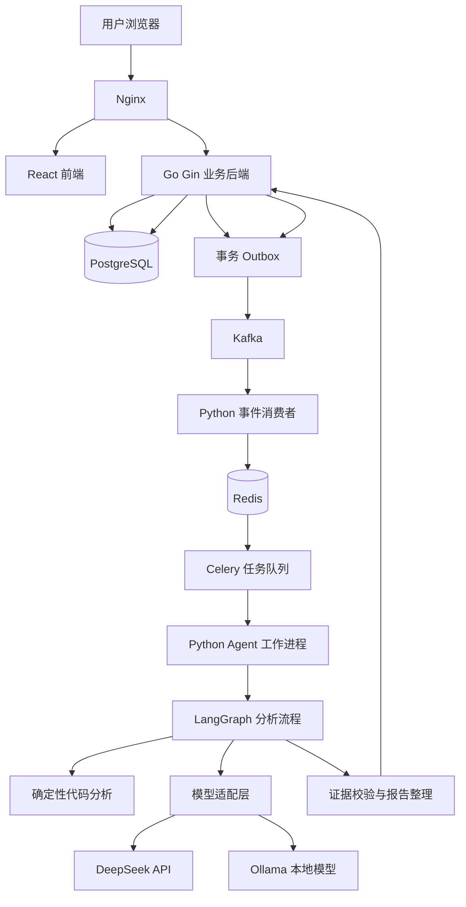
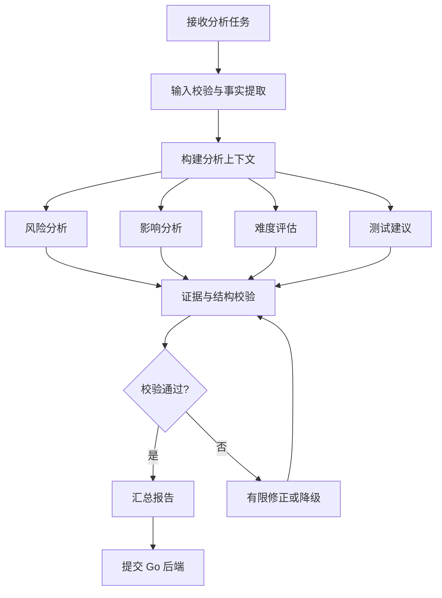

# 总体架构与技术决策

**项目名称：** CodeRisk——通用代码变更风险评估与任务难度量化多 Agent 系统  
**文档状态：** V1.0（最终设计基线；尚未编码实现）  
**文档定位：** 定义系统整体架构、模块职责、关键技术选型、跨服务协作机制及实施边界。  
**关联文档：**
- 《项目总纲.md》
- 《产品需求与业务规则.md》
- 《Agent 工作流与证据规范.md》
- 《认证权限与安全设计.md》
- 《系统接口与服务契约.md》
- 《数据库与任务状态设计.md》
- 《开发实施与验收计划.md》

---

## 一、设计目标

CodeRisk 不是简单地让多个 Agent 阅读代码并生成结论，而是构建一个具备业务闭环、证据追溯、异步处理和质量验证能力的代码变更分析系统。

架构设计遵循以下原则：

- **业务状态有唯一事实来源：** 用户、任务、报告及权限等业务数据由 Go 后端统一管理。
- **确定性分析优先于模型猜测：** 优先提取 Diff、AST、依赖关系和静态检查结果，再让 Agent 进行分析。
- **Agent 负责判断，不负责替代业务系统：** Agent 不直接修改业务数据库，不自行决定任务状态。
- **跨服务事件与内部任务队列分工明确：** Kafka 负责跨服务事件传递，Celery 负责 Python 服务内部的后台任务调度。
- **异步任务必须可靠：** 设计幂等、重试、超时、失败恢复和可追踪机制。
- **安全与测试从架构阶段开始：** 不执行用户任意代码，并对文件处理、外部访问和资源消耗实施限制。
- **先验证，再扩展：** 为后续接入更多语言、模型和检索能力预留接口，但不提前部署没有明确收益的组件。

## 二、整体架构

### 架构说明

系统划分为三个主要层次：

**业务层：** React、Nginx、Go、PostgreSQL。负责用户身份、任务生命周期、权限、报告持久化和业务一致性。

**分析层：** Python、LangGraph、代码分析工具、模型适配层。负责解析代码变更、组织 Agent 协作、校验分析证据和生成结构化结果。

**异步基础设施层：** Kafka、Redis、Celery。负责跨服务事件传递和 Python 服务内部的后台任务调度。

Embedding、向量数据库及独立静态分析服务属于按实际需求引入的能力，不应仅为丰富技术栈而强制部署。

## 三、技术选型与决策

| 领域 | 技术方向 | 主要职责 |
|---|---|---|
| 前端 | React、TypeScript、Vite、Ant Design | 用户界面、任务提交、进度展示、报告浏览 |
| 前端请求管理 | TanStack Query | 请求缓存、任务状态轮询、错误状态处理 |
| 反向代理 | Nginx | 统一入口、路由转发、请求体大小限制 |
| 业务后端 | Go、Gin | 身份认证、权限、业务规则、任务和报告管理 |
| 数据库 | PostgreSQL | 用户、任务、报告、审计记录、Outbox 等业务数据 |
| 事件总线 | Kafka | 跨服务事件传递、任务触发、生命周期事件通知 |
| AI 服务 | Python、FastAPI | Agent 服务接口、事件接收、内部回调 |
| Agent 编排 | LangGraph | 有状态分析流程、分支、并行、重试和结果汇总 |
| 内部任务队列 | Celery、Redis | Python 分析任务调度与后台执行 |
| 模型接入 | 统一模型适配层 | DeepSeek API 与后续 Ollama 模型接入 |
| 代码分析 | Diff、AST、依赖分析、静态检查 | 提取可验证的代码变更事实 |
| 容器化 | Docker、Docker Compose | 本地开发、集成测试及可复现部署 |
| 自动化测试 | Go/Python 测试框架、API 测试、负载测试 | 验证功能、可靠性和性能 |

以上为推荐技术方向。具体依赖版本、目录结构、接口细节和部署参数应在对应专项设计中进一步确定。

## 四、模块职责与边界

### 前端

负责：

- 注册、登录和会话状态管理。
- 提交 Diff 文本或 Diff 文件。提交前展示 Diff 会发送给外部模型，并要求用户确认。
- 展示任务状态、分析进度、错误信息、当前报告和同一线程的对话历史。
- 展示风险等级、难度评估、证据引用和测试建议。
- 发送追问和质疑。
- 对符合条件的失败任务提供手动重试。是否允许重试以后端任务查询给出的 `retry_allowed` 为准。
- 提供重新分析。只有源任务已经成功、部分成功或失败时才创建新任务，并继续显示旧报告。请求可以带可选 `user_note`。正在排队或分析时不能重新分析。前序报告和补充说明只作为待核查参考。
- MVP 不提供取消任务，也不提供仓库、Commit 或 PR 入口。

前端不负责最终权限判断、风险计算或任务状态流转。任何权限相关操作都必须由后端重新校验。

MVP 优先使用任务状态轮询。只有在真实使用中证明轮询带来明显延迟或资源开销后，才考虑 SSE 或 WebSocket。

### Go 业务后端

Go 是业务系统的权威入口和业务状态管理者。

负责：

- 邮箱注册、登录、令牌刷新及身份校验。
- 用户数据隔离和任务访问权限。
- 分析任务创建、六种状态的迁移、手动重试、当前尝试的失败收口和重新分析。
- 对话线程和对话消息的持久化。
- `attempt_no` 的分配，以及每个任务最多 4 次业务执行的控制。只在创建首个尝试和用户调用手动重试时分配下一次。失败回调、超时收口和基础设施恢复不分配下一次。
- 用现有恢复扫描区分仍在正常执行、正在恢复当前尝试、已确认无法恢复。确认无法恢复时走现有失败事务，不新增服务、队列或任务状态。
- HTTP 幂等键与 Kafka 消费去重的分别处理。
- 报告保存、查询和“一个任务只有一个当前有效报告”的约束。
- Outbox 事件记录与可靠发布。
- 分析结果回调的身份校验、幂等处理和业务状态更新。
- 审计日志、接口限流及必要的内部服务鉴权。

Python Agent 服务不得绕过 Go 直接修改业务数据库。所有业务状态变化和报告持久化均通过明确的内部接口完成。

### PostgreSQL

作为业务数据的唯一事实来源，保存：

- 用户与认证相关记录。
- 对话线程、对话消息、分析任务及任务状态。
- 每个任务的一份 Diff、执行尝试和当前有效报告。
- HTTP 幂等记录、Kafka 消费记录和 Outbox。
- 外部模型确认记录或等价审计事件。

核心表关系与报告 JSONB 基线以《数据库与任务状态设计》为准；字段类型、索引和 SQL 约束在迁移实现时验证。Diff 默认保留 30 天，报告与证据默认保留 90 天，具体以《认证权限与安全设计》为准。原始 Diff 清理后，历史报告仍可查看，但不再支持基于该输入重新分析。MVP 不保存仓库克隆快照。

### Python AI 服务

负责：

- 接收 Kafka 的分析事件和对话回复事件，并交给 Celery。
- 调用代码分析工具，执行 LangGraph 分析流程。
- 为追问生成回复。回复只依据本线程消息、被引用报告和证据。
- 通过 Go 内部接口提交分析结果、失败信息或对话回复。
- 记录模型调用、耗时、Token 消耗及分析失败原因。日志不包含原始 Diff、完整对话正文、密钥或 Token。

Python 不分配 `attempt_no`，不创建业务任务，也不直接写 PostgreSQL。分析用的 LangGraph 检查点按 `task_id` 与 `attempt_no` 隔离；某次追问的检查点按 `thread_id` 与该次事件标识隔离。重复投递只能恢复同一次执行，不能把两个尝试或两条线程的状态写到一起。检查点不是业务事实来源。检查点完成而 PostgreSQL 尚无回复时，只能用原 `event_id` 向 Go 提交；Go 已有回复则停止该次执行。重新分析时必须重新读取新任务的 Diff 并重新取证。前序报告和 `user_note` 只能作为待核查参考，不能当成已证实事实，也不能用整段历史对话代替这份输入。追问只使用 Go 已绑定的报告及其同报告对话，不把其他任务的内容当作当前事实。普通追问不创建分析任务。

Python 不承担用户权限系统和业务数据库的直接写入职责。

### Kafka

负责跨服务事件传递，而不是代替 PostgreSQL 保存任务状态。

主要用途：

- 通知 AI 服务存在新的分析任务。
- 发布任务完成、失败等业务事件。
- 为后续增加通知、统计或其他消费者保留扩展能力。

Kafka 中的事件是传递和协作机制，不是任务当前状态的最终依据。

### Redis 与 Celery

Redis 为 Celery 提供任务队列及相关运行能力。Celery 负责 Python 内部的任务分发、执行调度和重试机制。

二者不能替代 Kafka：

- Kafka：跨服务事件总线。
- Celery：Python 服务内部的后台任务队列。
- PostgreSQL：业务任务状态和报告的事实来源。

不得让三个系统各自维护一套互不一致的业务任务状态。

## 五、一次分析任务的完整流程

### 用户提交

1. 用户登录，确认 Diff 会发送给外部模型，然后提交 Diff 文本或 Diff 文件。
2. Go 校验身份、确认记录、请求参数和资源限制。
3. Go 在同一数据库事务中创建线程、第一个任务、该任务的 Diff 和 Outbox 事件。
4. 接口返回 `thread_id` 与 `task_id`。前端查询任务状态；分析完成后再进入对话。

### 任务触发

1. Outbox 发布器读取待发布事件并发送到 Kafka。
2. Python 事件消费者收到分析请求事件。
3. 消费者按 `event_id` 做消费去重，并核对其中的 `attempt_no`。不能只按 `task_id` 去重，否则同任务的下一次合法业务执行会被丢掉。
4. 消费者将任务交给 Celery。只有 Celery 可靠接收后才提交 Kafka Offset。
5. 重复投递不能新建任务、不能增加 `attempt_no`，也不能提交第二份当前报告。投递失败则不提交 Offset，并依靠 Outbox 和原尝试记录恢复，避免任务永久停住。

### 代码分析

1. 校验输入来源、文件大小、格式和路径。
2. 建立受控临时工作目录。
3. 获取或规范化 Diff。
4. 提取变更文件、增删行、符号、AST 结构及依赖信息。
5. 根据分析范围执行必要的静态检查。
6. 将确定性事实整理为结构化证据。
7. 将证据交给 LangGraph 编排的分析流程。

### Agent 分析

1. 根据任务类型构建统一分析上下文。
2. 调度风险分析、影响分析、难度评估和测试建议等分析节点。
3. 对可独立执行的节点进行有限并行。
4. 对关键结论进行证据引用与一致性校验。
5. 汇总结构化报告。
6. 检查报告字段、引用有效性和不确定性标记。

### 结果提交

1. Python 通过经过鉴权的内部接口向 Go 提交结果。回调包含 `task_id`、`attempt_no`、`event_id`。
2. Go 校验调用方、当前尝试、预期状态和结果类别。过期或重复回调被拒绝。
3. Go 在数据库事务中保存该任务唯一的当前有效报告，并把任务更新为 `SUCCEEDED` 或 `PARTIAL_SUCCESS`。
4. 同一事务可以写入对应的 Outbox 事件。前端通过任务和报告接口读取结果。
5. 用户随后可以在原线程追问。追问走 `conversation.reply_requested`，不进入上述分析尝试。

若当前尝试无法形成可用结果，Python 通过现有失败回调提交。Go 在同一事务中结束该尝试、保留失败原因，并把任务记为 `FAILED`。该事务不分配下一个 `attempt_no`，也不发布下一次业务执行。用户只能在任务已是允许重试的 `FAILED`、没有未结束尝试且已分配次数少于 4 次时，调用手动重试开始下一次业务执行。并发手动重试只有一方分配编号。`PARTIAL_SUCCESS` 不自动补跑，也不能手动重试。

当前尝试超过 Go 配置的运行期限并经恢复判断确认无法继续，或发布/排队等待超期且无法恢复时，现有恢复扫描走同一套失败事务，把任务收口为 `FAILED`。已进入 `RUNNING` 且运行期限已到时使用 `EXECUTION_TIMEOUT`；发布/排队等待超期且无法恢复，或运行期限未到但当前尝试已中断且无法恢复时使用 `EXECUTION_INTERRUPTED`。仅超过期限但仍处于有效恢复窗口的任务不得提前收口。仍在对应期限内正常执行，或同一尝试仍在恢复窗口内的任务，不得被收口，也不得因此分配下一次业务执行。MVP 默认配置：发布/排队等待期限 120 秒、执行期限 180 秒、恢复判定窗口 60 秒；由服务端配置注入，不由请求体传入，后续只能依据故障测试调整。这是设计约束，恢复扫描本身尚未实现。

用户只能在源任务已经是 `SUCCEEDED`、`PARTIAL_SUCCESS` 或 `FAILED` 时重新分析。Go 在创建新任务的同一事务中关联前序 `task_id`、已有当前有效报告时的前序 `report_id`，以及可选 `user_note`，并保存不可变 Diff 副本。新任务从 `PENDING` 与 `attempt_no = 1` 开始。无前序报告时不编造 `report_id`。

## 六、任务状态与可靠性设计

### 任务状态

建议先采用有限且清晰的状态集合：

- `PENDING`：任务已创建，等待可靠发布。
- `QUEUED`：本次业务执行已发布，等待运行。用户手动重试后的下一次业务执行排队时也使用该状态。同一尝试的恢复投递不是新状态。
- `RUNNING`：本次业务执行正在分析。
- `SUCCEEDED`：分析完成，当前报告已持久化。终态。
- `PARTIAL_SUCCESS`：核心风险分析完成，非核心分析有失败。终态，不自动补跑。
- `FAILED`：没有形成可用的核心分析结果，或当前尝试已确认无法继续恢复。终态。只有用户手动重试，且失败类型允许、次数未用尽时，才能转回 `QUEUED`。

没有 `CANCELLED`，也没有任务级 `RETRY_WAIT`。状态迁移以《数据库与任务状态设计》为准。前端不得自行推断或指定 `attempt_no`。

### 幂等机制

Kafka、Celery 和网络请求都可能发生重复投递或重复调用，因此不能假设消息只处理一次。

至少需要：

- 使用 `task_id` 关联一次分析，使用 `thread_id` 关联对话，使用 `attempt_no` 关联一次业务执行。三者不能互相替代。
- HTTP 创建幂等与 Kafka `event_id` 去重分开。相同幂等键、不同内容必须拒绝。
- 分析结果回调以 `task_id`、`attempt_no`、`event_id` 幂等。旧尝试不能覆盖当前报告。
- 手动重试留在原任务，并遵守“最多一个未结束尝试”的事务规则。失败回调不分配下一次业务执行。重新分析只从终态源任务创建新任务，并保留旧报告。
- 继续对话只追加消息，不占用业务执行次数。

系统以幂等方式实现业务上的重复安全，不承诺所有基础设施都具备严格的端到端 Exactly-once 语义。

### 事务 Outbox

Go 在创建任务或更新任务状态时，将业务数据变更和待发布事件写入同一个 PostgreSQL 事务。

独立发布器负责将 Outbox 事件发送到 Kafka，并在确认发布后更新事件处理状态。

这样可以避免数据库事务已经提交、但进程在发布 Kafka 消息前崩溃而导致事件丢失。

Outbox 事件可能重复发送，因此消费者仍必须幂等。发布器需要具备失败重试、积压监控和异常事件排查能力。

### 重试与死信

重试策略应区分：

- **业务执行：** 每个任务最多 4 次。只有 Go 分配 `attempt_no`，且只在创建首个尝试和用户调用手动重试时分配下一次。
- **模型调用和 LangGraph 纠错：** 只在当前尝试内进行，不新建任务，不增加 `attempt_no`。
- **Kafka、Celery 与恢复扫描：** 只恢复同一次投递或同一次执行。超时和基础设施故障都不直接分配下一次业务执行。
- **输入错误：** 进入 `FAILED` 后不接受手动重试。
- **重复或过期事件：** 按 `event_id`、当前尝试和任务状态跳过。已经收口为失败的尝试，迟到的成功回调按过期回调拒绝。

Kafka 死信和 Celery 失败队列只服务于各自的基础设施边界。它们不是用户可见的手动重试，也不能绕过 Go 的次数限制。MVP 默认基础设施退避采用指数退避并加随机抖动，间隔约 1 秒、2 秒、4 秒，单条基础设施恢复链路最多 3 次自动重投；达到上限后进入可观测的失败/死信处理，不分配新的业务尝试。

## 七、代码分析与证据体系

代码风险分析不能完全依赖 LLM 对代码的自由阅读。

建议采用以下处理顺序：

**输入规范化 → 确定性事实提取 → Agent 分析 → 证据校验 → 报告生成。**

### 确定性事实提取

根据语言和输入类型逐步支持：

- Git Diff 解析和变更统计。
- 文件类型与语言识别。
- 函数、类、方法等符号识别。
- AST 结构和必要的调用关系分析。
- 变更文件与上下游依赖的关联。
- 可用静态检查工具输出。
- 测试文件及测试覆盖线索识别。

每项分析能力必须说明其支持范围和已知局限，不能把简单文本匹配描述为完整的语义理解或全量调用图分析。

### 证据对象

建议统一证据结构，至少包含：

- 证据 ID。
- 证据类型。
- 文件路径。
- 行号或 Diff 位置。
- 可验证的事实描述。
- 来源工具及必要的原始引用。
- 与风险、难度或测试建议的关联关系。

Agent 输出结论时，应引用对应证据。无法获得足够证据的结论，应降低置信度或标记为待确认，而不是生成虚假的确定性结论。

### Agent 结论的边界

风险等级、任务难度和影响范围是不同维度，不应混为一谈。

- 风险分析回答“变更可能造成什么问题”。
- 影响分析回答“哪些模块或调用路径可能受到影响”。
- 难度评估回答“完成和验证该任务需要多少理解、协调及实现工作”。
- 测试建议回答“应当验证哪些行为和边界条件”。

报告应区分确定性事实、分析判断和未经验证的假设。

## 八、Agent 编排与上下文管理

### 编排原则

采用 LangGraph 构建有状态、可观测的分析流程，而不是让一个 Agent 无限自由地规划和调用工具。具体节点、Risk/Hardness 枚举、证据对象、报告契约和成功条件统一以《Agent 工作流与证据规范》为准。

推荐的逻辑流程：

上述流程是逻辑设计，不代表每个节点必须部署为独立微服务。初期可将多个分析节点放在同一个 Python 服务中。

### 主控 Agent 的职责

主控节点负责：

- 根据任务类型选择有限的分析分支。
- 传递经过筛选的证据和上下文。
- 协调分析节点之间的依赖。
- 控制并行度、当前执行内部的纠错次数和总体时限。这里的次数不是业务 `attempt_no`。
- 检查分析结果是否完整。
- 在证据不足或模型不可用时执行降级策略。

主控节点不能无限创建子任务、无限调用工具或无限循环反思。

### 上下文管理

MVP 不把仓库克隆进模型上下文。分析优先提供：

1. 当前任务自己的 Diff。
2. 从该 Diff 重新提取的符号、依赖和静态分析结果。
3. 追问只提供 Go 在接受消息时绑定的那份报告、它的证据，以及绑定同一报告的历史对话。其他任务的消息和报告不作为当前事实。重新分析只额外接收本次请求中的 `user_note` 和前序报告，二者都标记为待核查的历史材料，不自动带入全部历史消息。

上下文不足时记录缺失信息。不建立跨任务长期记忆。对话历史的权威副本在 PostgreSQL，由 Go 写入。

### 记忆设计

MVP 不需要独立的长期记忆 Agent。

- **任务内状态：** 使用 LangGraph 状态保存当前任务的分析上下文。
- **持久化业务数据：** 由 Go 和 PostgreSQL 管理。
- **仓库知识：** 按需检索代码符号、文档和分析证据。
- **用户长期偏好：** 暂不作为核心能力。

如果后续出现跨任务复用仓库约定、历史风险模式等明确需求，再设计可更新、可追溯的项目级知识。

## 九、RAG、Embedding 与向量数据库决策

检索能力需要解决具体问题，不能仅为了体现技术栈而引入。

### 不同信息采用不同检索方式

| 信息类型 | 优先方案 | 原因 |
|---|---|---|
| 当前 Diff | 直接解析 | 输入明确，无需向量检索 |
| 文件、函数、类 | 路径和符号索引 | 结果确定、易于追溯 |
| 调用关系和依赖 | AST、依赖分析 | 需要结构关系，而非单纯语义相似度 |
| 仓库内规范文档 | 关键词检索，必要时语义检索 | 适合按主题检索自然语言内容 |
| 历史分析报告 | 结构化过滤与关键词检索，后续再评估语义检索 | 需要结合语言、文件、风险类型等条件 |
| 大量非结构化技术文档 | Embedding 与向量检索 | 适合语义相关内容召回 |

### MVP 推荐

先完成代码结构化事实提取和可追溯检索，再用真实任务验证语义检索的必要性。

如果需要语义检索，建议先评估 PostgreSQL 全文检索与 pgvector 的组合，以减少独立基础设施数量。

Milvus 保留为可选方案。当向量数据规模、并发、检索延迟、过滤能力或运维需求确实超过当前方案的合理范围时，再通过对比实验决定是否引入。

### 检索评估

是否引入 RAG、Embedding 或 Milvus，应至少观察：

- 相关代码和文档的召回率。
- 检索结果的准确性。
- Agent 引用证据的有效率。
- 因检索遗漏导致的分析错误。
- 检索延迟、资源消耗和维护成本。

如果语义检索没有改善分析质量，不应因为使用了向量数据库就认定方案更先进。

## 十、模型适配与成本控制

### 模型接入

通过统一模型适配层隔离业务流程与具体模型供应商。

首期优先接入 DeepSeek API；后续使用 Ollama 进行本地模型实验。模型适配层统一处理：

- 请求和响应格式。
- 超时与错误分类。
- 限流与有限重试。
- 模型配置与能力声明。
- Token 用量和耗时记录。
- 结构化输出校验。

不同模型的工具调用、结构化输出和上下文能力可能不同，不能假设只修改模型名称就能保证行为完全一致。

### 本地模型实验

开发设备为 16 GB 内存、RTX 4060 Laptop 8 GB 显存的笔记本。可将适合该资源条件的量化代码模型作为实验候选，通过实际运行评估速度、显存占用和分析质量。

本地实验结果不能直接代表云端生产性能。MVP 不要求自建高可用模型推理集群。

### 成本与失败控制

每个分析任务需要有明确的预算。Agent 节点调用和修正次数以《Agent 工作流与证据规范》为准；部署配置仍需给出模型请求超时、总执行期限、Token/费用上限和发布/排队等待期限，并通过本地测试校准：

- 当前业务尝试的执行期限，以及发布或排队后的等待期限。二者放在 Go 服务配置中，由恢复扫描使用，不在本文写死秒数，也不由请求体传入。
- 模型调用次数上限、Token 或费用预算、并行分析节点数量上限，以及当前尝试内部的有限重试。这些属于 Python 当前尝试内部预算，不得换成新的 `attempt_no`。
- 模型不可用时，先在当前尝试内失败或降级；仍无法完成时，由 Go 把该尝试记为 `FAILED`，再由用户决定是否手动重试。

外部模型调用会把 Diff 和必要的对话上下文发送给模型供应商。用户提交前必须被告知并确认，Go 留存确认记录或审计事件。同一线程的后续追问和重新分析沿用这次已留存的确认。MVP 由平台服务端统一管理模型凭据，不接收或持久化用户自带 Key；认证、限额、保留期与日志安全以《认证权限与安全设计》为准。

## 十一、工具调用与 MCP 边界

工具的作用是提供受控、可验证的能力，不是让 Agent 获得任意系统权限。

建议统一工具契约：

- 工具名称及用途。
- 输入参数和校验规则。
- 输出结构。
- 权限要求。
- 超时和资源限制。
- 可重试错误及不可重试错误。
- 审计字段和调用记录。

MVP 中，代码解析、Diff 提取和静态分析可以先作为 Python 内部工具实现。只有在确实需要跨进程、跨服务复用，或者需要统一工具发现与调用协议时，才将相应能力暴露为 MCP 工具。

不要求所有内部函数都封装成 MCP Server。

禁止 Agent 通过工具执行任意 Shell 命令、运行未知构建脚本或访问任意内网地址。

## 十二、安全与资源隔离

虽然 MVP 不执行用户代码，也不克隆仓库，但解析 Diff 和调用静态分析工具仍需要限制资源。

### 输入安全

- 限制 Diff 文本和 Diff 文件的体积、处理时间与临时空间。输入默认上限统一采用安全专项中的 Diff 1 MiB、最多 500 个变更文件、增删行合计 20,000 行和 5 秒解析时限。
- 拒绝把仓库地址、Commit、PR、路径穿越和任意 URL 当作分析输入。
- 仓库克隆、压缩包快照和 SSRF 防护留到相应接入真正进入范围时再实现，不作为 MVP 的当前输入路径。
- 对临时文件进行隔离、权限限制和定期清理。

### 进程与网络安全

- 静态分析工具使用最低必要权限运行。
- 不以 root 身份运行不可信输入处理任务。
- 设置 CPU、内存、进程数和执行时间限制。
- 默认禁止分析工作进程访问不必要的网络资源。
- 不执行用户提交的程序、测试脚本、构建脚本或安装钩子。
- 未来若加入代码执行，必须单独设计强隔离执行环境，不能直接沿用当前处理方式。

### 身份和数据隔离

- 所有业务接口以服务端认证身份确定当前用户。
- 查询线程、对话消息、任务和报告时强制校验归属。用户只能访问自己的数据。
- 内部回调采用独立服务身份鉴权。
- Refresh Token 的存储、轮换、撤销及失效策略应在认证专项设计中确定。
- 日志中不得记录密码、完整访问令牌、模型密钥等敏感信息。
- 任务错误信息不得泄露其他用户的代码或报告。

## 十三、数据库与数据一致性

### 责任边界

PostgreSQL 保存业务状态和持久化报告；Kafka 保存待传递的跨服务事件；Celery/Redis 负责内部后台任务调度。

代码临时目录、模型上下文和消息队列都不能取代数据库中的权威任务状态。

### 结果提交

报告和任务状态应在同一业务事务中更新，避免出现“报告已保存但任务仍显示运行中”或“任务已成功但报告不存在”的不一致。

对于同一任务的重复回调：

- 已成功的任务不应被旧的失败回调覆盖。
- 重复成功回调不应重复创建报告。
- 过期或非法状态转换应被拒绝并记录。

### 数据保留

应明确区分：

- 需要长期保留的业务任务和报告。
- 为诊断问题而短期保留的执行日志。
- 仅在分析过程中使用的临时代码文件。
- 可重新计算的缓存或检索索引。

保留期限、删除策略和备份策略在部署及数据管理设计中确定。

## 十四、可观测性与故障定位

必须能够回答三个问题：

1. 一个分析任务目前进行到了哪一步？
2. 任务变慢或失败发生在哪个组件？
3. 问题来自业务逻辑、队列积压、数据库、静态分析还是模型调用？

### 日志

使用结构化日志，关键字段至少包括：

- `trace_id`
- `task_id`
- `user_id`（内部关联标识，避免不必要的个人信息）
- `component`
- `stage`
- `duration_ms`
- `error_code`

不得把原始 Diff、完整对话正文、令牌或密钥写入常规日志。

### 指标

重点采集：

- API 请求量、错误率和延迟。
- 分析任务成功率、失败率和总耗时。
- Kafka 消费延迟、积压量和重试量。
- Celery 队列长度、任务执行时长和失败量。
- PostgreSQL 连接池使用率、慢查询和连接等待。
- Redis 内存和连接情况。
- 模型调用延迟、超时率、Token 消耗及成本。
- CPU、内存和临时磁盘占用。

### 链路追踪

以 `trace_id` 关联 Go 请求、Outbox 发布、Kafka 消费、Celery 任务、Agent 节点和最终回调。

MVP 可先使用结构化日志与核心指标，再根据排障需求接入完整分布式追踪系统。不能因为尚未部署独立追踪平台，就省略跨服务关联标识。

## 十五、测试与性能验证架构

测试是系统架构的一部分，不是开发结束后才补充的工作。

### 测试层次

**单元测试：** 业务规则、状态转换、幂等逻辑、Diff 解析、证据校验及 Agent 节点逻辑。

**接口测试：** 注册登录、权限隔离、任务创建、任务查询、报告查询、错误处理和内部回调。

**集成测试：** PostgreSQL、Outbox、Kafka、Python 消费者、Celery、Redis 和 Go/Python 之间的完整交互。

**端到端测试：** 用户提交任务，系统完成代码分析并生成可追溯报告。

**安全测试：** 越权访问、跨用户数据泄露、恶意文件、路径穿越、SSRF、请求滥用和敏感信息泄露。

**负载测试：** 并发提交、持续任务处理、队列积压、数据库连接池、模型限流和长时间运行稳定性。

**Agent 质量测试：** 固定代码变更样本、风险分类、证据引用、难度评估一致性、测试建议有效性和无证据结论比例。

### 两轮验证

第一轮建立可运行的 MVP 基线，记录实际结果，包括：

- API P50/P95 延迟。
- 任务端到端 P50/P95 耗时。
- 任务成功率、超时率和失败率。
- 并发量、吞吐量和队列积压。
- 数据库连接池等待和慢查询。
- CPU、内存和磁盘使用。
- Agent 质量指标及模型成本。

第二轮针对第一轮真实发现的瓶颈进行优化，再使用尽可能一致的数据集、并发条件、硬件和模型配置重复测试。

每次优化都需要记录问题证据、改动内容、预期收益、测试条件和实际结果。不得提前设定未经验证的提升百分比，也不得通过故意降低第一轮质量制造优化成果。

## 十六、部署与环境规划

### 开发与演示环境

优先使用 Docker Compose 管理必要服务：

- 前端及 Nginx。
- Go 业务后端。
- Python AI 服务及工作进程。
- PostgreSQL。
- Kafka。
- Redis 与 Celery。

可以在开发阶段按需要分别启动前端、后端和 Agent 服务。服务配置、密钥和环境变量不得硬编码在仓库中。

### 部署原则

- 开发、测试和演示环境配置可复现。
- 服务启动顺序不应被误认为服务始终可用；依赖异常需要健康检查和重试。
- 数据库迁移必须可追踪。
- 关键配置与模型供应商凭据通过环境变量或适当的密钥管理机制注入。
- 记录容器资源限制及必要的持久化卷。
- 预留 CI 自动化测试和镜像构建流程。

MVP 不要求 Kubernetes、多集群部署或复杂服务网格。

## 十七、关键决策记录

| 决策项 | 当前建议 | 状态 |
|---|---|---|
| 业务后端 | Go + Gin | 推荐确定 |
| AI 服务 | Python + FastAPI + LangGraph | 推荐确定 |
| 业务数据库 | PostgreSQL | 推荐确定 |
| 跨服务消息 | Kafka | 明确纳入架构 |
| Python 内部任务队列 | Celery + Redis | 推荐确定 |
| 任务状态归属 | Go 业务后端与 PostgreSQL | 推荐确定 |
| 跨服务事件发布 | 事务 Outbox | 推荐确定 |
| 重复投递处理 | 幂等消费与幂等回调 | 必须设计 |
| Agent 编排 | 受控 LangGraph 工作流 | 推荐确定 |
| 代码分析 | Diff、AST、依赖和静态分析 | 分阶段实现 |
| RAG | 根据实际检索需求引入 | 待验证 |
| 向量数据库 | 优先评估 PostgreSQL + pgvector | 待验证 |
| Milvus | 暂不默认引入 | 待验证 |
| MCP | 仅用于需要标准化复用的工具 | 按需引入 |
| 模型接入 | DeepSeek API，后续评估 Ollama | 推荐路线 |
| 前端任务进度 | 初期轮询，必要时再引入 SSE | 推荐路线 |
| 任意代码执行 | MVP 禁止 | 明确排除 |
| 完整分布式追踪平台 | 先建立关联日志与核心指标 | 分阶段实现 |
| Kubernetes | MVP 不引入 | 明确排除 |

“推荐确定”表示建议作为当前设计基线，后续仍可基于实现证据修订；“待验证”表示需要通过需求、实验或测试形成正式决策，不能提前声称已经实现。

## 十八、主要风险与应对

| 风险 | 应对措施 |
|---|---|
| Agent 输出看似合理但缺乏证据 | 确定性分析优先、证据引用、结构校验 |
| Kafka 重复投递造成重复结果 | 幂等消费、唯一约束、幂等回调 |
| 任务状态与队列状态不一致 | PostgreSQL 作为事实来源，明确状态转换 |
| 模型响应慢或供应商不可用 | 超时、有限重试、预算控制和明确失败状态 |
| 仓库过大导致上下文溢出 | Diff 优先、相关符号检索、上下文裁剪 |
| RAG 或向量库增加复杂度却没有收益 | 使用固定评测集验证后再决定 |
| 多个基础设施增加维护负担 | 保留必要组件，避免提前引入集群与微服务拆分 |
| 用户输入导致文件或网络安全问题 | 文件限制、路径校验、SSRF 防护、受控临时目录 |
| 测试结果无法复现 | 固定样本、记录环境、配置和测试条件 |
| 模型成本随并发增长 | 任务预算、调用限制、并发控制与成本指标 |

## 十九、后续专项设计文档

整体架构确认后，建议依次补齐：

- 《系统接口与服务契约.md》：Go/Python API、内部回调、Kafka 事件结构。
- 《数据库与任务状态设计.md》：表结构、索引、状态机、幂等和 Outbox。
- 《Agent 工作流与证据规范.md》：分析节点、输入输出、证据结构、上下文及失败策略。
- 《代码分析与检索设计.md》：Diff、AST、依赖分析、RAG 和向量检索决策。
- 《认证、权限与安全设计.md》：邮箱认证、令牌策略、用户隔离、文件处理和网络安全。
- 《测试与性能验证方案.md》：测试样本、基线指标、负载场景、优化记录和验收标准。
- 《部署与可观测性设计.md》：Compose、配置、日志、指标、健康检查及故障恢复。

专项文档不应重复抄写总纲，而应把本文件中的架构原则转化为可实现、可验证的接口、数据结构、规则和验收标准。

## 二十、实施前置检查

进入代码实现前，至少确认：

- [ ] 产品需求和 MVP 范围已与 PRD 一致。
- [ ] Go 对业务状态和 PostgreSQL 的所有权边界明确。
- [ ] Kafka 与 Celery 的职责和事件流明确。
- [ ] 任务状态机、Outbox、幂等与失败恢复已有设计。
- [ ] Agent 分析流程、证据结构和报告格式可验证。
- [ ] RAG、Embedding、pgvector 和 Milvus 的取舍已记录为正式决策或待验证事项。
- [ ] 认证、用户数据隔离和文件处理安全要求已纳入设计。
- [ ] 第一轮测试基线及第二轮同条件复测的方案已经规划。
- [ ] 文档与代码仓库现状完成对照，未把设计目标误当作现有实现。

**本文件的最终目标：** 在不过度建设的前提下，为 CodeRisk 建立清晰的业务边界、可靠的异步协作机制、可追溯的 Agent 分析流程，以及从第一版就可验证的工程质量体系。
