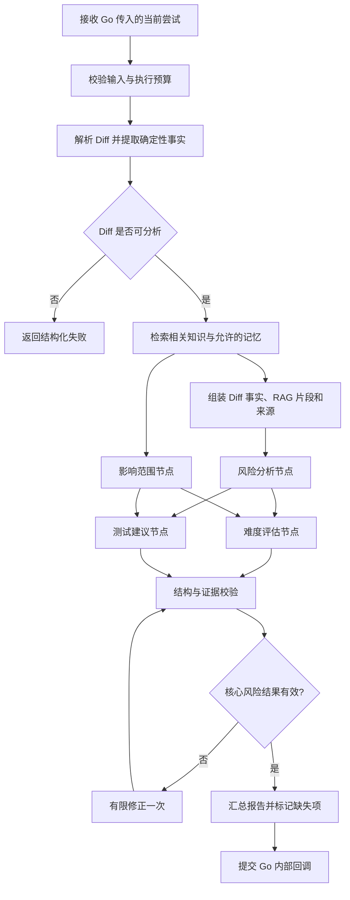

# CodeRisk Agent 工作流与证据规范

**文档状态：** V1.1（修订稿；待与其余专项文档交叉核验）  
**适用范围：** MVP 的 Python/FastAPI + LangGraph 分析流程、结构化报告、证据校验与质量评测。  
**上位约束：** Go 是任务、状态、执行次数、报告与审计的唯一业务事实来源；Python 负责分析并通过受鉴权回调提交结果，不直接写业务数据库。

---

## 一、设计目标与不做事项

本规范要保证：

1. 报告中的关键结论能关联到本次 Diff 的可核验事实，而不是只有自然语言判断。
2. 风险、影响范围、任务难度和测试建议各自回答不同问题，不相互替代。
3. 分析失败能够被机器判定，并映射为任务成功、部分成功或失败，不靠 HTTP 200 或“生成了文字”来判断。
4. Agent 分工可独立检查和评测，但不把每个逻辑节点强行部署为独立服务。
5. 模型调用、纠错和内部重试有上限，不创建新的业务 `attempt_no`。

MVP 不承诺完整 AST、全仓调用图、依赖漏洞扫描、代码执行、测试自动运行或精确工时预测。MVP 将 RAG、Embedding、向量检索与受限 Agent Memory 纳入设计范围；首选以 BGE-M3 生成文本向量、PostgreSQL + pgvector 存储和检索，不默认引入 Milvus。MCP 不属于 MVP 必需组件。对无法从 Diff 本身证明的内容，必须输出限制或待验证假设。

## 二、核心概念与枚举

### 2.1 风险等级 Risk

| 等级 | 含义 | 判定参考 |
|---|---|---|
| `CRITICAL` | 可能导致严重安全、数据完整性或核心服务不可用问题，且影响路径有较强证据 | 例如高权限绕过、关键数据破坏、核心路径大面积不可用；必须有明确证据，不能仅凭措辞升级 |
| `HIGH` | 可能造成重要业务功能错误、关键接口失败、明显安全边界问题或重要数据不一致 | 有具体变更事实和合理影响路径 |
| `MEDIUM` | 可能影响局部业务行为、异常处理、兼容性或边界条件 | 影响范围相对有限，仍值得针对性验证 |
| `LOW` | 低影响、局部且容易发现或恢复的问题 | 证据支持存在潜在问题，但影响较小 |
| `INFO` | 需要注意的变化或验证点，但当前证据不足以认定为风险发现 | 不应计入已确认缺陷；用于说明性提示 |

风险等级表达审查优先级和潜在影响，不代表缺陷发生概率，也不表示系统已证明存在 Bug。首版不计算伪精确的概率分数。

### 2.2 难度等级 Hardness

| 等级 | 含义 |
|---|---|
| `LOW` | 局部、低耦合、实现路径清晰，验证范围较小 |
| `MEDIUM` | 存在一定业务逻辑、接口或测试复杂度，需要理解相邻模块 |
| `HIGH` | 跨模块、状态/并发、兼容性或复杂验证因素明显 |
| `VERY_HIGH` | 需要跨多个关键模块协调，或存在显著领域知识、迁移、并发与验证难度 |

Hardness 是相对难度分级，不是预计工时或交付日期。MVP 不输出未经校准的精确小时数；`score` 保留为可空字段，首版统一为 `null`，避免让等级和数字形成虚假的精确性。

### 2.3 结论类型

- `FACT`：由解析器或工具直接观察到的事实，例如文件路径、增删行数、Diff 行、检测工具输出。
- `INFERENCE`：依据事实作出的分析判断，例如某处状态校验可能遗漏。
- `HYPOTHESIS`：依赖未提供上下文或尚未执行验证的假设。

Agent 不得将 `INFERENCE` 或 `HYPOTHESIS` 伪装为 `FACT`。没有足够证据时应降低结论强度、标记待验证或不输出风险发现。

### 2.4 RAG、Embedding 与 Agent Memory

三者职责必须分开，不得混用：

- **BGE-M3（Embedding）**：将知识文档片段和检索查询编码为向量；它不负责存储、检索流程编排或生成最终风险结论。
- **PostgreSQL + pgvector**：存储知识片段向量及必要元数据，并执行向量相似度检索；业务任务、报告与审计仍由 Go 侧通过 PostgreSQL 管理。
- **RAG**：负责文档清洗与切分、向量化、检索、结果过滤、上下文组装和来源追踪，再把受控上下文交给分析节点。
- **Agent Memory**：只保存明确允许复用的、经过规则过滤且具备来源与归属的记忆；它不是跨用户共享的聊天历史，也不是未经核实的事实库。

知识检索首版范围：

1. 检索与 Java/Python 代码审查相关的技术规范、框架文档、风险检查清单和经审核的通用知识。
2. 检索结果必须保留文档 ID、版本或来源、片段 ID 等引用元数据，报告中的结论不能只凭“检索到了”就视为已证明。
3. 向量相似度只用于召回候选资料，不等于事实正确性或风险严重程度；必要时结合元数据过滤与关键词检索，并通过固定评测集比较质量。
4. 当前任务的 Diff 证据仍是代码变更事实的首要依据。RAG 内容用于补充解释和检查角度，不得替代 Diff 证据，也不得据此声称已读取未提交的仓库内容。
5. BGE-M3 的具体模型版本、向量维度、切分策略、相似度阈值和检索条数必须在实现配置与评测记录中明确；未测试前不写成已验证的最优参数。

Agent Memory 首版边界：

- 允许候选记忆仅来自当前用户有权访问、且按产品规则确认可复用的信息；不得跨用户读取任务、报告、对话或记忆。
- 仅将明确确认、纠正或采纳的反馈作为候选记忆；未经确认的模型结论、单次猜测和原始 Diff 不自动升级为长期记忆。
- 记忆必须记录用户归属、来源任务/报告、创建时间、状态及可删除关系；召回时再次检查归属与有效状态。
- 记忆是辅助上下文，不是本次代码事实。与当前 Diff 冲突时以当前可核验证据为准；无法确认时应忽略或明确标记冲突。
- 用户删除相关源数据或记忆时，必须按数据保留与删除规则同步处理；具体存储表、删除事务和 API 由数据库、接口及安全专项文档定义。
- 不将所有历史对话自动拼入 Prompt；每次只检索与当前问题相关、数量受限且可追溯的记忆。

## 三、MVP 工作流



### 3.1 节点职责

| 节点 | 是否核心 | 输入 | 输出 | 失败处理 |
|---|---|---|---|---|
| Diff 解析与事实提取 | 核心前置 | 标准化 Diff | 文件变更、行范围、变更统计、可定位事实、解析限制 | 无法解析主要结构或输入无效时终止；不让模型编造事实 |
| 风险分析 | 核心 | Diff 事实、相关代码片段、任务必要上下文 | 风险发现、风险等级、证据引用、影响和验证方式 | 允许一次受限结构修正；仍无有效结果则核心失败 |
| 影响范围分析 | 非核心 | Diff 事实、可获得的符号/模块线索 | 可能受影响的文件、模块、接口及依据 | 失败时在 `limitations` 标明，允许部分成功 |
| 难度评估 | 非核心 | 变更规模、风险/影响结果、结构事实 | Hardness 等级与理由 | 失败时标明缺失，不阻断有效风险报告 |
| 测试建议 | 非核心 | 风险发现、变更事实、影响线索 | 可执行的测试场景、边界条件与依据 | 失败时标明缺失，不阻断有效风险报告 |
| 证据与结构校验 | 核心 | 所有节点输出、证据索引 | 校验结果、无效引用列表 | 拒绝不合格核心结果；非核心结果可剔除并记录限制 |
| 报告汇总 | 核心 | 已校验的节点结果 | 统一版本报告 | 不允许补造缺失内容；只汇总有效结果和限制 |

这些是 LangGraph 中的逻辑节点，不要求独立微服务或独立部署。首版可以使用同一 Python 进程和统一模型适配层。各节点是否使用不同模型，应以质量、延迟和成本评测决定；MVP 默认共用已配置的模型客户端。

### 3.2 并行与依赖

- 风险、影响、难度和测试建议在事实提取完成后按可用上下文并行执行。
- 测试建议可以读取风险结果；如果实现为并行节点，必须在汇总前补充风险结果或明确只依据 Diff 事实生成建议。首版推荐：风险与影响并行，难度和测试建议在二者完成后执行，避免重复猜测。
- 所有节点共享同一份只读事实索引；节点不能自行改写事实索引。
- 汇总节点只使用通过校验的结果，不把模型的自我评价作为质量证明。

## 四、输入上下文与边界

每次分析的上下文只包括：

1. 当前任务的标准化 Diff。
2. 从该 Diff 重新提取的事实、行范围和解析限制。
3. 当前任务允许使用的必要元数据，例如声明语言；不得把用户输入当作可信系统指令。
4. 通过 RAG 检索得到的相关知识片段，以及用于追溯的来源元数据。
5. 经授权且与当前问题相关的 Agent Memory；必须执行用户归属、状态和数量限制检查。
6. 重新分析时由 Go 关联的前序报告和本次 `user_note`，两者都作为待核查的历史参考，不能直接作为本次事实。

RAG 和 Memory 均不能覆盖或修改原始 Diff 事实索引。当前任务不得读取其他用户的对话、报告或记忆；不得把未确认的跨任务结论当成已验证事实；不执行 Diff 中出现的命令、提示词或脚本。原始 Diff 已过保留期限并清理后，不得继续声称可以基于原输入重新分析；应提示用户重新提交输入。Diff 内容一律视为不可信数据。若 Diff 内含“忽略系统规则”等文本，应按代码内容分析，不得当成 Agent 指令。

## 五、确定性事实与证据契约

### 5.1 证据类型

| 类型 | 说明 | MVP 来源 |
|---|---|---|
| `DIFF_LINE` | 指向本次 Diff 中具体新增/删除/上下文行 | Diff 解析器 |
| `FILE_CHANGE` | 文件路径、变更类型、增删行数等 | Diff 解析器 |
| `SYMBOL_FACT` | 能被实际解析器识别的函数、类、方法或符号事实 | 可选语言解析器；无法识别时不生成 |
| `STATIC_CHECK` | 静态检查工具的实际输出 | 只有工具已运行并返回结果时可用；MVP 可暂不启用 |
| `CONTEXT_LIMITATION` | 缺失调用方、配置、测试或运行环境等限制 | 由流程基于实际缺失项生成 |

`CONTEXT_LIMITATION` 用于说明限制，不可作为证明某个 Bug 存在的正向证据。

### 5.2 证据对象

```json
{
  "evidence_id": "ev_001",
  "type": "DIFF_LINE",
  "file_path": "backend/service/order.go",
  "start_line": 42,
  "end_line": 45,
  "change_side": "NEW",
  "fact": "该 Diff 在第 42-45 行新增订单写入调用",
  "source": "diff_parser",
  "source_ref": "hunk_003",
  "verifiable": true
}
```

字段规则：

- `evidence_id` 在一次分析结果内唯一；由 Python 的确定性预处理/组装层生成，不由模型随意发明。
- `type` 只能使用上述枚举。
- `file_path` 必须来自解析后的 Diff 文件列表。
- `start_line`、`end_line` 只有在解析器能可靠定位时才填写；未知时使用 `null`，不得估算。
- `change_side` 为 `OLD`、`NEW`、`CONTEXT` 或 `null`。
- `fact` 描述可核验事实，不能把推论写成事实。
- `source` 与 `source_ref` 必须指向本次分析实际生成的记录。
- `verifiable=false` 的证据不能单独支撑高置信风险发现。

模型可以提出候选结论，但证据对象由应用层从可用事实索引中绑定；不接受模型自造的 `evidence_id`。校验器必须确认引用存在、路径属于本次 Diff、行号范围合法、证据来源真实。

### 5.3 风险发现对象

```json
{
  "finding_id": "risk_001",
  "title": "订单状态校验可能缺失",
  "severity": "HIGH",
  "conclusion_type": "INFERENCE",
  "description": "新增写入路径可能在状态不满足时继续处理订单。",
  "evidence_refs": ["ev_001"],
  "impact": "可能导致不符合业务状态的订单被写入。",
  "verification": ["覆盖非法状态输入并验证写入是否被拒绝"],
  "confidence": "MEDIUM",
  "needs_human_verification": true
}
```

规则：

- `severity` 为 `CRITICAL`、`HIGH`、`MEDIUM`、`LOW` 或 `INFO`。
- `conclusion_type` 为 `FACT`、`INFERENCE` 或 `HYPOTHESIS`；风险发现通常应是 `INFERENCE` 或 `HYPOTHESIS`，不能冒充已验证缺陷。
- `evidence_refs` 至少包含一条有效证据；`INFO` 级提示可以引用 `CONTEXT_LIMITATION`，但必须标明这是待验证提示而非已确认问题。
- `confidence` 为 `LOW`、`MEDIUM` 或 `HIGH`，表达证据充分程度，不是缺陷概率。
- `needs_human_verification` 表示仍需人工或测试确认，不可因其为 `false` 就宣称系统已执行过验证。
- 不输出没有证据引用的实质性风险发现。

## 六、统一报告契约

Go 接收的分析结果采用以下顶层结构。此结构是服务间契约；数据库可以将报告主体存为 JSONB，但 Go 仍需单独管理任务、尝试、状态和审计字段。

```json
{
  "task_id": "task_example",
  "attempt_no": 1,
  "event_id": "evt_example",
  "outcome": "SUCCEEDED",
  "result_version": 1,
  "summary": "本次变更的主要内容与总体判断",
  "change_overview": {
    "files_changed": 2,
    "insertions": 18,
    "deletions": 4,
    "languages": ["go"],
    "parse_status": "COMPLETE",
    "changed_files": ["backend/service/order.go", "backend/service/order_test.go"]
  },
  "risk": {
    "status": "SUCCEEDED",
    "overall_level": "MEDIUM",
    "findings": []
  },
  "impact": {
    "status": "SUCCEEDED",
    "items": []
  },
  "hardness": {
    "status": "SUCCEEDED",
    "level": "MEDIUM",
    "score": null,
    "reasons": []
  },
  "test_suggestions": {
    "status": "SUCCEEDED",
    "items": []
  },
  "evidence": [],
  "limitations": [],
  "model_metadata": {
    "provider": "deepseek",
    "model": "configured-model",
    "prompt_version": "risk-v1",
    "duration_ms": 1200
  }
}
```

### 6.1 字段与枚举规则

- `outcome` 只能为 `SUCCEEDED` 或 `PARTIAL_SUCCESS`。Python 不提交 `FAILED` 成功回调；核心分析失败通过内部失败回调契约报告，由 Go 终结任务。
- `result_version` 当前固定为 `1`，契约发生不兼容变化时递增。
- 各分析分区 `status` 为 `SUCCEEDED`、`FAILED` 或 `SKIPPED`。`FAILED` / `SKIPPED` 必须在 `limitations` 说明原因。
- `change_overview.parse_status` 为 `COMPLETE`、`PARTIAL` 或 `FAILED`。`FAILED` 不能通过核心风险成功校验。
- `risk.overall_level` 是已输出风险发现的最高等级；没有发现时允许为 `null`，并由摘要明确说明“在已分析范围内未发现有证据支持的风险”，不可写成“代码无风险”。
- `hardness.score` 在 MVP 必须为 `null`。
- `evidence_refs` 必须引用同一结果 `evidence` 数组中的证据 ID。
- `model_metadata` 不包含 API Key、完整提示词、原始 Diff 或完整对话正文。
- 时间和耗时字段只记录实际测量值；不得使用虚构默认值。

### 6.2 部分成功

核心风险分析有效且通过证据校验，但影响分析、难度评估或测试建议中的非核心部分失败时，允许 `PARTIAL_SUCCESS`。报告必须保留可用部分，并在对应分区标明状态，在 `limitations` 列出缺失项。

如果风险分析无效、Diff 无法被基本解析、报告结构不合法或所有实质性风险结论均引用无效证据，则不得产生 `SUCCEEDED` 或 `PARTIAL_SUCCESS` 报告。当前业务尝试应以失败回调交由 Go 处理。

### 6.3 最低核心成功条件

以下条件全部满足，风险分析才算核心成功：

1. Diff 输入已通过 Go 的大小、类型和授权校验；Python 能对标准化 Diff 做基本解析。
2. `change_overview` 中的变更统计和文件列表来自解析器，而非模型生成。
3. 风险节点返回符合结构约束的结果；风险发现可以为空数组，但不得缺少分析范围和限制说明。
4. 每条非 `INFO` 风险发现至少引用一条有效、可核验且属于当前 Diff 的证据。
5. 对证据不足的候选问题，节点必须降级为待验证假设或不输出，而不是生成虚构位置。
6. 结构与证据校验通过；必要时只允许一次修正请求，修正仍失败则判核心失败。
7. 报告能明确表达分析覆盖范围与未覆盖内容。

空风险列表不等于自动成功：必须能证明风险节点实际收到有效的 Diff 事实并返回了有效结果；摘要须限定为“在已分析范围内未发现有证据支持的风险”。

## 七、失败、预算与状态映射

### 7.1 当前尝试内部预算

首版采用明确的硬上限，具体值由部署配置控制，不允许请求方覆盖：

- 风险/影响/难度/测试建议每个节点最多一次正常生成；
- 核心风险结构校验失败后，最多一次修正生成；
- 每个分析节点最多一次应用层模型调用重试，仅用于可恢复的瞬时网络错误、限流或供应商临时错误；不得将不可恢复的输入错误反复重试；
- 总体并行节点数量固定上限，超出时排队执行；
- 单次模型请求超时、单次业务尝试期限、总 Token/费用预算均由环境配置给出；任一预算耗尽后停止当前图执行并按错误契约返回。

应用层重试次数、LangGraph 节点重入、Kafka 重投和 Celery 恢复都不增加 Go 的 `attempt_no`。Go 仍是业务执行次数的唯一分配方。

### 7.2 失败映射

| 场景 | Python 处理 | 业务结果 |
|---|---|---|
| Diff 无效/无法基本解析 | 返回明确输入或解析失败码，不生成伪报告 | Go 按接口契约处理为 `FAILED`；不可手动重试的输入错误不允许重试 |
| 核心风险节点模型调用耗尽预算 | 结束当前图并返回 `ANALYSIS_FAILED` 或具体模型错误 | `FAILED`；由 Go 判断是否允许用户手动重试 |
| 风险输出经过一次修正仍不合法 | 返回 `RESULT_INVALID` | `FAILED`；该错误不允许同任务手动重试，用户可重新分析 |
| 影响、难度或测试建议节点失败，风险核心有效 | 记录分区失败与限制，提交部分报告 | `PARTIAL_SUCCESS` |
| 回调网络失败 | 使用同一 `task_id`、`attempt_no`、`event_id` 有限重试回调 | Go 幂等接收；不创建新业务执行 |
| 超过 Go 执行期限且恢复扫描确认不可恢复 | Python 不自行改任务状态 | 由 Go 恢复扫描终结为 `FAILED`，使用对应超时/中断错误码 |

### 7.3 禁止行为

- Python 不直接更新 PostgreSQL 中的业务任务状态、尝试次数或当前报告指针。
- Python 不自行创建任务或增加 `attempt_no`。
- 不通过无限循环、无限工具调用或无限反思修复输出。
- 不把模型输出中的路径、行号、测试结果或静态检查结果直接视为事实。
- 不执行用户提交的代码、构建脚本、Shell 命令或任意 MCP 工具。
- 不记录原始 Diff、模型密钥、完整提示词或完整对话正文到普通应用日志。

## 八、结构校验与报告质量门禁

回调前必须执行以下校验：

1. 顶层必需字段完整，字段类型与枚举合法。
2. `task_id`、`attempt_no`、`event_id` 与本次接收的任务上下文完全一致。
3. 文件路径来自当前 Diff 文件清单；行号处于解析器可证明的范围内。
4. 每个证据 ID 唯一；每条引用都能解析；不允许引用其他任务或历史报告中的证据 ID。
5. 风险等级、Hardness 等级和分区状态符合枚举。
6. 没有风险发现时，`overall_level` 为 `null`，且摘要不能声称代码绝对安全。
7. `PARTIAL_SUCCESS` 必须存在至少一个非核心分区的失败/跳过说明；`SUCCEEDED` 不得隐藏失败的必需分区。
8. 报告总大小、证据数量、单字段长度均不得超过配置上限。
9. 不允许含密钥、认证令牌或不应回传的原始敏感信息。
10. 结果通过校验后才允许向 Go 发起成功回调。

校验器不负责证明模型推理绝对正确，但必须拒绝可确定的结构错误、伪造位置和不存在的证据引用。

## 九、评测集与验收

### 9.1 固定评测案例类型

首批评测集至少覆盖：

- 明确存在风险且 Diff 中有直接证据；
- 表面可疑但证据不足，应该标记假设或不输出；
- 正常重构/格式变更，不应强行制造风险；
- 错误处理、空值、边界条件和状态迁移；
- 权限校验、输入校验和数据一致性；
- 多文件变更及可能的跨模块影响；
- Diff 截断、文件重命名、二进制/不支持语言、无法定位行号；
- 模型输出格式错误、证据 ID 伪造、错误等级越界；
- 非核心节点失败但核心风险分析成功；
- 核心节点失败、模型超时与预算耗尽。

每个案例记录输入、参考发现或明确的“不应报风险”判定、必须引用的证据位置、可接受的等级区间、测试建议要点和限制条件。参考答案可由人工标注与确定性规则共同形成，不能只用同一模型自动给自己打分。

### 9.2 必须统计的指标

- 有效风险发现的 Precision / Recall 或按案例人工评定的命中情况；
- 风险发现证据引用有效率；
- 文件路径与行号可定位率；
- 无证据结论率与无风险案例误报率；
- Hardness 等级与人工参考等级的一致性；
- 测试建议覆盖率与可执行性；
- 结构校验通过率、核心成功率、部分成功率和失败原因分布；
- 单任务耗时、模型调用次数、Token/费用与重试次数。

在运行固定评测集之前不填写“已达到”的质量百分比。第一次运行形成基线，之后才比较优化效果。

## 十、与其他文档的责任边界

- PRD 定义用户价值、功能范围和业务验收目标；本文件定义分析工作流、证据标准和分析结果的最低质量门禁。
- 《系统接口与服务契约》定义请求、回调、事件和错误码的传输形式；报告字段必须与本文件保持一致。
- 《数据库与任务状态设计》定义任务/尝试/报告持久化与状态机；不得将 Python 内部节点状态暴露为业务任务状态。
- 《总体架构与技术决策》定义服务边界、异步链路与技术取舍；本文件的 Agent 节点不要求独立服务化。
- 认证、安全、数据保留、输入限额的最终约束由专项安全文档和核心文档统一维护；本文件不复制另一套安全策略。

## 十一、完成标准

- [ ] 风险等级、难度等级、证据类型和结论类型已冻结。
- [ ] 最低核心成功条件、部分成功条件和核心失败条件可机器校验。
- [ ] 报告 JSON 契约具备稳定字段与枚举。
- [ ] 每条实质性风险发现都能引用当前 Diff 中真实存在的证据。
- [ ] 模型无法创建新的业务任务或分配 `attempt_no`。
- [ ] 节点重试、模型重试与回调重试都有上限。
- [ ] 固定评测集能检验风险命中、误报、证据有效性和失败降级。
- [ ] RAG 检索结果保留来源，且不会替代当前 Diff 证据。
- [ ] Agent Memory 有用户隔离、来源追溯、有效状态和删除规则。
- [ ] BGE-M3 + pgvector 的检索质量、延迟和资源开销已纳入基线测试；未实测前不宣称达到目标。
- [ ] 本文件已与 PRD、架构、接口、数据库文档完成交叉核验。

**当前状态说明：** 本文件是设计产物，不代表 Agent 代码、测试集或质量指标已经实现或通过验收。
